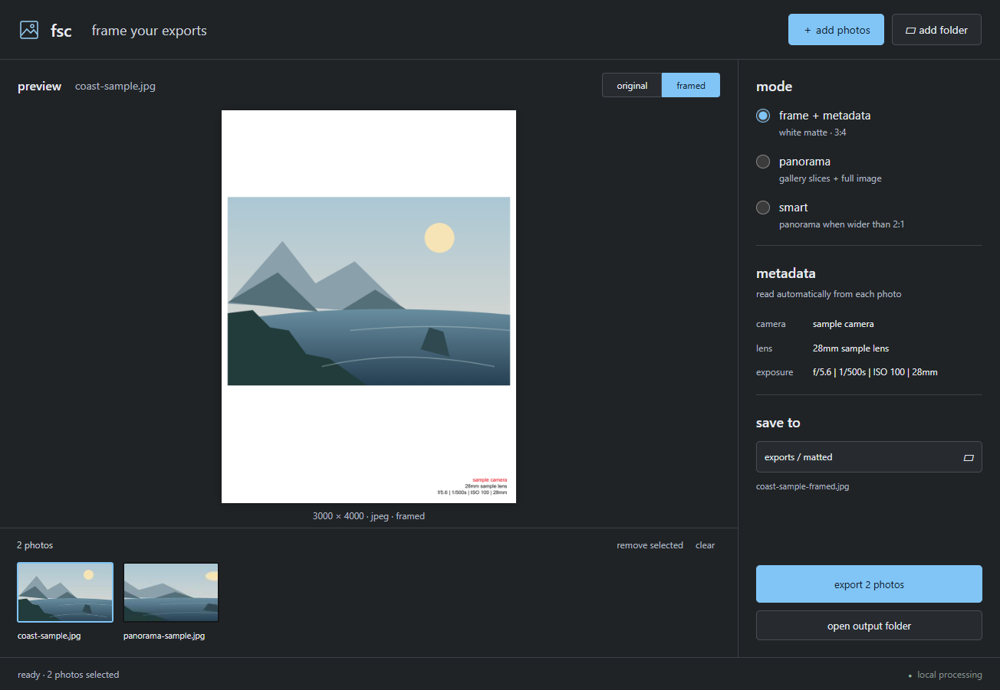

# fsc

a small desktop app for framing jpeg exports with camera, lens, and exposure
metadata. includes seamless panorama galleries and a compatible command line.



## use

[download the windows app](https://github.com/Fuiste/fsc-desktop/releases/latest).
extract the whole zip and open `fsc.exe`; no separate runtime installation is needed.

open `fsc.exe`, then add photos, add a folder, or drag files onto the window.
select a thumbnail to see its original or rendered output.

click **reset** in the top toolbar to clear the current batch, preview, and export
status. your selected processing mode stays selected. the next folder gets its
own default `matted` destination. reset never deletes source photos or exports
and is unavailable while importing or exporting.

- **frame + metadata:** white 3000 × 4000 matte, camera name in red, lens and exposure below.
- **panorama:** two slices below 2:1, three slices at 2:1 or wider, plus the full framed photo. click the preview's slice buttons to inspect each output.
- **smart:** panorama for images strictly wider than 2:1; ordinary framing otherwise.

the default destination is a `matted` folder beside the first selected photo.
click the destination to change it. exports use `photo-framed.jpg`, or
`photo-framed-1.jpg` etc. for panoramas. existing files are preserved; collisions
get a numbered suffix. originals are read only. stopping an export finishes the
current photo before stopping. individual failures do not abort the rest.

only jpeg input is supported. folders are scanned one level deep. images with
no usable camera/exposure metadata get a plain matte and a visible notice.
orientation is applied before rendering. the standard frame retains the original
tool's no-upscaling behavior, so small photos occupy less of the matte.
panorama mode can upscale and vertically crop to make adjoining slices meet.
exports are quality-100 jpeg; the visible metadata is rendered into the border,
not preserved as a complete embedded EXIF archive. preserve source files for archival use.

## windows build

requires node 22 or later and pnpm 11.25.0. from this directory:

```sh
pnpm install --frozen-lockfile
pnpm test
pnpm test:gui
pnpm start
pnpm dist
```

extract the entire resulting windows zip, then run `fsc.exe`. keep its adjacent
resources and dlls in place. the runtime is bundled; end users do not need node,
bun, or a connection to another computer. the build is unsigned.

the app uses a sandboxed renderer with an isolated preload bridge, no remote
content, and no network requests for image processing.

## cli

```sh
node app/cli.mjs photo.jpg
node app/cli.mjs ./exports --smart -o ./matted
node app/cli.mjs panorama.jpg --panorama
```

the original `fsc` input and mode flags are preserved. without arguments the cli
processes the current directory into `./matted`. with explicit input and no output
flag, results go beside the originals. unlike the original cli, filename collisions
never overwrite files. `pnpm link --global` optionally installs the `fsc` command.

## validation

tests generate their own jpeg fixtures and cover metadata, renderer parity,
orientation, missing metadata, smart thresholds, panorama counts, collisions,
corrupt files, cancellation, and folder discovery. the gui smoke test exercises
preview, selection, panorama navigation, export, repeat export, and clearing.

see [provenance](NOTICE.md). licensed under the [mit license](LICENSE).
